# AI-ready Arista EVPN-VXLAN Multi-Site Fabric, Automated with SaltStack


A three-data-center Arista EVPN-VXLAN network, built in EVE-NG and run entirely as code with **SaltStack + NAPALM**.
Every switch configuration is **generated from one source of truth** (pillar data + Jinja templates) and pushed as an
**atomic full-config replace**. EOS previews every change before it lands, and manual drift is detected and reverted.
The design is the **front-end, storage and DCI fabric of an AI data center**, and is structured to extend to a GPU back-end.

| | |
|---|---|
| **Scale** | 3 data centers · 11 Arista vEOS switches · Cisco IOSv internet edge |
| **Overlay** | BGP EVPN, VXLAN, symmetric IRB, anycast gateway, MLAG, EVPN ESI multihoming |
| **Multi-site** | DC1 ↔ DC3: RFC 9014 multi-domain EVPN gateway (L2 stretch + Type-5) · DC1 ↔ DC2: VRF-lite DR site |
| **Automation** | Salt 3007 · NAPALM proxy minions over eAPI · `netconfig.managed` replace · offline render + semantic diff |
| **Outcome** | All 11 switches managed as code, **zero drift**, two hand-built DCs onboarded **without an outage** |

---

## Topology

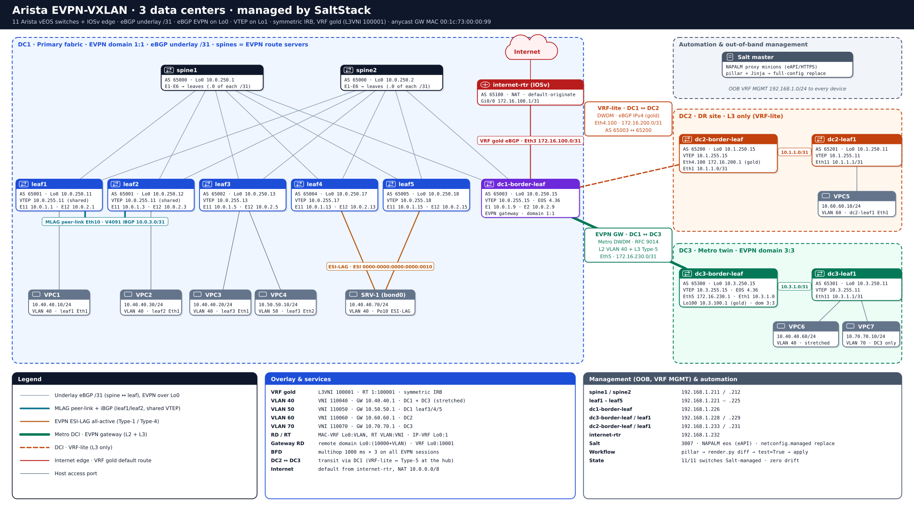

<sub>Editable source: [docs/diagrams/Topology.drawio](docs/diagrams/Topology.drawio) (open in diagrams.net; File → Export as → VSDX for Visio) · printable one-pager: [docs/Topology_OnePager.docx](docs/Topology_OnePager.docx)</sub>

<details><summary>Simplified view (Mermaid)</summary>

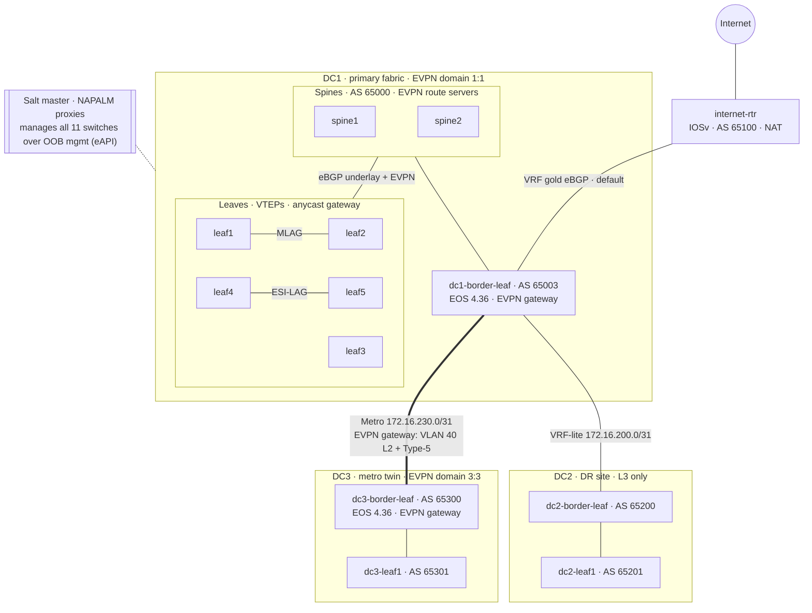
</details>

Addressing, VLAN/VNI plan and the gateway walkthrough: [docs/ARCHITECTURE.md](docs/ARCHITECTURE.md)

## Highlights

- **RFC 9014 multi-site EVPN gateway** between DC1 and DC3: each DC keeps its own VTEPs and failure domain; VLAN 40 is stretched and subnets are routed (Type-5) through three stitched VXLAN tunnels.
- **One template, every role.** Spines, leaves, border leaves, spine-less "hub" border leaves and EVPN gateways all render from `leaf.j2` / `spine.j2`, with behaviour driven by data.
- **Safe change pipeline.** Offline render + semantic diff → EOS config-session preview (`test=True`) → atomic commit, one switch at a time.
- **Brownfield onboarding without an outage.** DC2 and DC3 were built by hand, captured, diffed against the templates until only intentional differences remained, then applied leaf-first with BGP and data-plane checks after each switch.
- **Mixed EOS versions** (4.31 / 4.36) handled with a per-device `eos_train` attribute instead of forked templates.
- **Secrets never in git.** Credentials and password hashes stay on the Salt master; backups are published with hashes redacted.

## AI-ready fabric

An AI data center runs two networks. This repo builds the first one and is structured to extend to the second.

| Network | Job | In this repo |
|---|---|---|
| **Front-end + storage + DCI** | Users, APIs, data ingest, checkpoint/storage traffic, multi-site resilience | ✅ This fabric: EVPN-VXLAN, VRFs, anycast gateway, RFC 9014 multi-site gateway, BFD |
| **Back-end (GPU fabric)** | GPU-to-GPU collective traffic (all-reduce, all-to-all) over RoCEv2 | Roadmap: design + pillar-driven templates |

**Why the design suits AI workloads**
- **Multi-site EVPN gateway**: each site stays its own failure domain; only what must be shared crosses the DCI.
- **Pure L3 eBGP underlay with wide ECMP** (`maximum-paths 4 ecmp 64`), the same scale-out pattern GPU back-ends use.
- **Generated, not typed**: VNIs, RTs, gateways and peerings come from one source of truth, so a new leaf is one pillar entry. That is what hundreds of racks require.
- **Fast failure detection and consistency**: BFD on every EVPN session, atomic commits, zero-drift enforcement.

**How the model extends to a GPU back-end**

| Requirement | Why it matters | How it maps to this repo |
|---|---|---|
| Lossless Ethernet for RoCEv2 | RDMA collectives stall on packet loss | Pillar `qos:` profile → PFC on the no-drop class, ECN thresholds, DCQCN, rendered by the same templates |
| Rail-optimized topology | Each GPU NIC rail lands on its own leaf | `uplinks:` already generates the spine side; add a `rail:` attribute |
| 400G/800G, buffers, load balancing | Few, very large (elephant) flows | Per-platform defaults, same mechanism as `eos_train` |
| Telemetry | Spot congestion and PFC storms early | gNMI → Prometheus → Grafana (roadmap) |

vEOS-lab cannot emulate lossless behaviour; back-end templates are validated here by render/diff and belong on hardware for real testing.

**AI in operations**
- **Built with AI assistance, under guardrails.** An AI assistant helped draft templates, diffs and documentation. Nothing reached a switch without the offline `render.py` diff, the EOS `test=True` diff and human approval, one switch at a time.
- **Roadmap: "ask the network" AIOps assistant.** An LLM with **read-only** Salt tools (BGP/EVPN state, drift, configs) for natural-language troubleshooting ("why can't VPC7 reach DC2?"). Any change it suggests is a pillar diff that goes through render → `test=True` → human approval.

## How the automation works

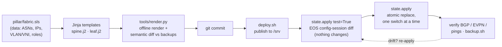

| Role | Devices | What gets generated |
|---|---|---|
| `spine` | spine1-2 | Downlinks + underlay/EVPN neighbors generated from every device whose `uplinks` point at it |
| `leaf` | leaf1-5, dc2-leaf1, dc3-leaf1 | VTEP, anycast gateway, MAC-VRFs, IP-VRF; peers = whatever its `uplinks` land on |
| `border` | dc1-border-leaf | Leaf without SVIs + VRF-lite edge (internet, DC2) |
| `border` + hub | dc2/dc3-border-leaf | No spines in that DC: downlinks and BGP to local leaves generated like a spine |
| `border` + `dci_gateway` | dc1/dc3-border-leaf | RFC 9014 gateway: metro underlay + `DCI-UNDERLAY-OUT`, `domain remote` peer, domain IDs, stretched VLANs (remote RD `Lo0:10000+VLAN`), VRF `domain all` RTs |

- **Stretch VLAN 50 to DC3** = add `50` to `stretched_vlans` on both gateways and to `vlans:` on dc3-leaf1, then render, preview, apply.
- **Add a leaf** = one device entry with its `uplinks:`; both spines get the downlink, underlay and EVPN neighbor automatically.

## Design decisions

| Decision | Why |
|---|---|
| **Full-config replace**, not merge | The switch ends up exactly as rendered: drift and leftovers are removed, and the commit is atomic (EOS config session) |
| **Offline semantic diff before any push** | Reviewing `render.py` output against backups catches pillar mistakes without touching a device |
| **EVPN multi-domain gateway for DC1↔DC3** instead of one flat EVPN domain | Each DC keeps its own VTEP set and failure domain; only the gateways' VTEPs cross the DCI; BUM traffic crosses once |
| **VRF-lite to DC2** | DR site needs L3 only; simplest, firewall-friendly hand-off |
| **Hub role generated from leaf data** | DCs without spines reuse the spine logic; adding a DC3 leaf configures dc3-border-leaf automatically |
| **`eos_train` per device** | EOS 4.36 shows different default lines than 4.31; one attribute instead of forking the template |
| **Secrets out of git** | eAPI credentials and password hashes live only on the master (`_creds.yaml`, `users.sls`); backups are stored redacted |

## Diagrams and design documents

| | |
|---|---|
| 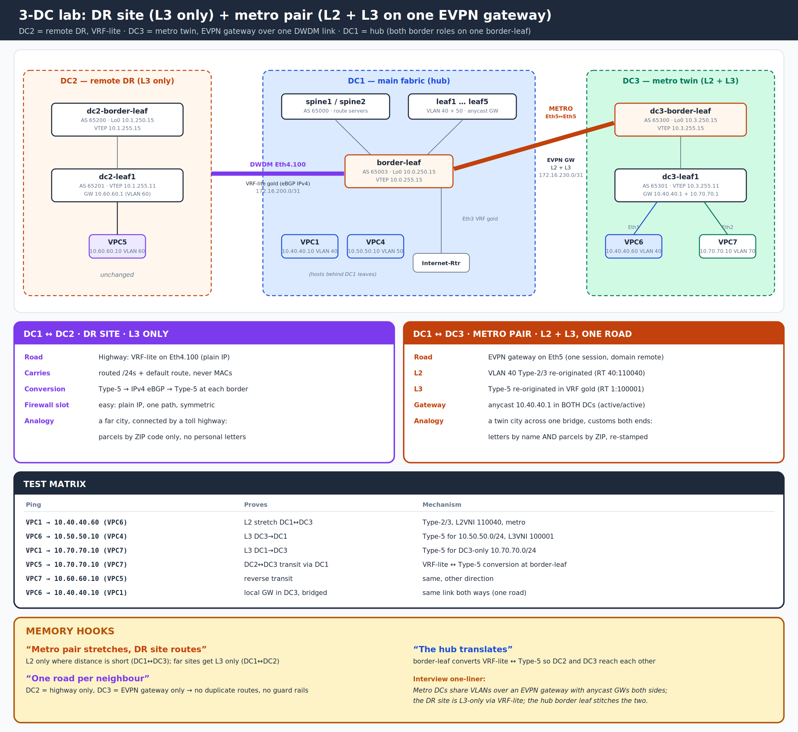 | 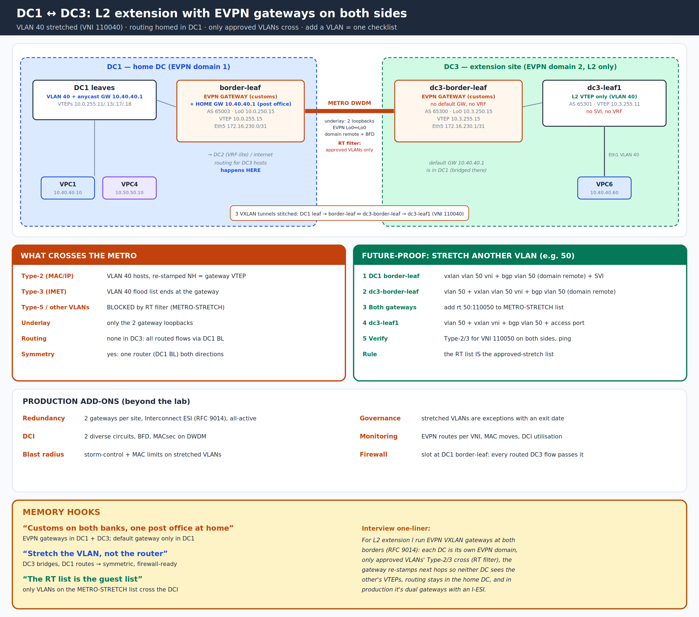 |
| **3-DC design**: metro twin + DR site | **DC1 ↔ DC3 L2 extension** through EVPN gateways |
| 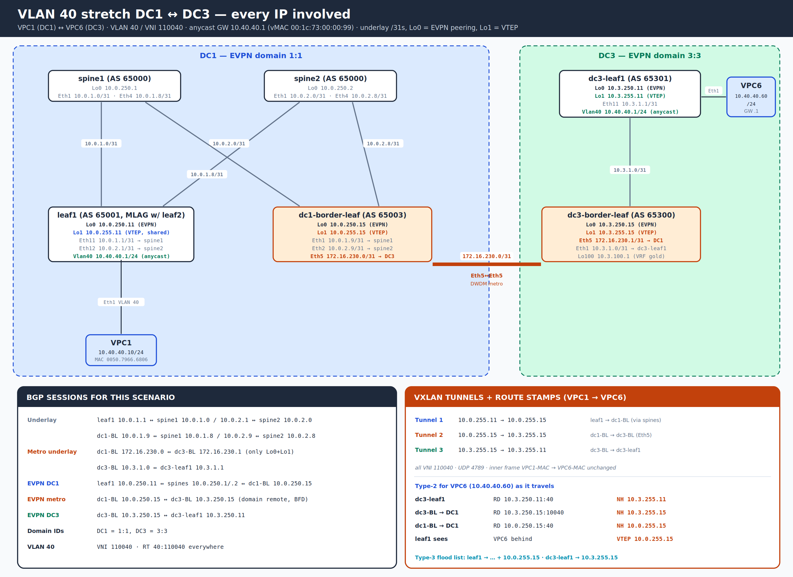 | 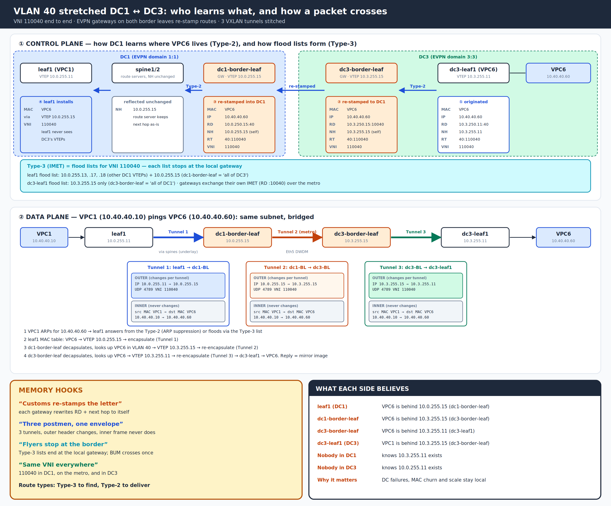 |
| **VLAN 40 stretch**: every IP, tunnel and route stamp | **Control plane vs data plane** for the stretch |
| 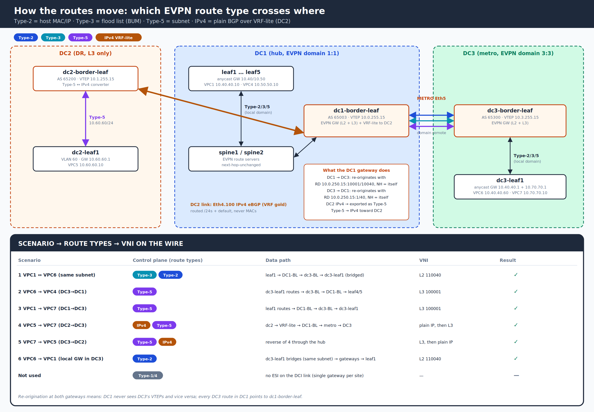 | 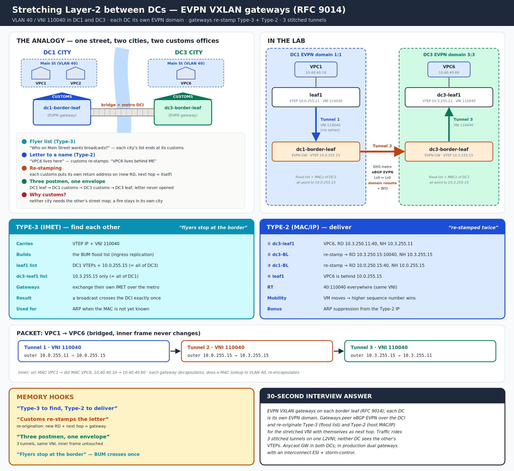 |
| **EVPN route types** per segment | **L2 stretch via gateway**, explained |
| 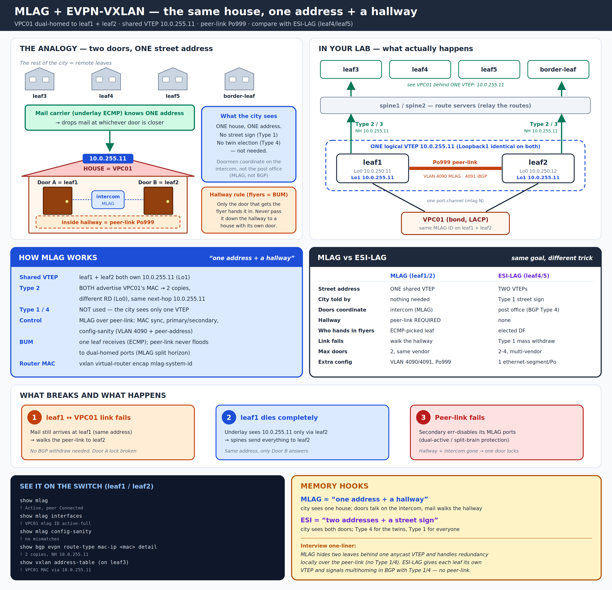 | 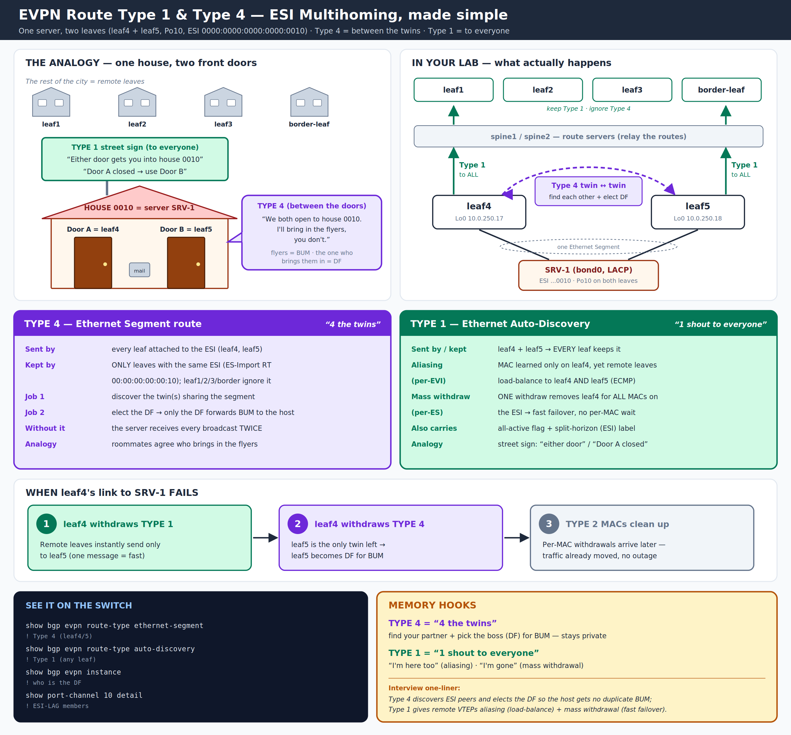 |
| **MLAG** with EVPN (leaf1/leaf2) | **EVPN multihoming**: Type-1 / Type-4 (leaf4/leaf5) |

Design documents (PDF, readable in the browser; Word versions linked):
- [DC1 ↔ DC3 Metro DCI with EVPN Gateways](docs/DC1_DC3_Metro_DCI_EVPN_Gateway.pdf) ([Word](docs/DC1_DC3_Metro_DCI_EVPN_Gateway.docx)): goals, design, configuration walkthrough, route types, test results
- [VLAN 40 Stretch DC1 ↔ DC3](docs/VLAN40_Stretch_DC1_DC3_EVPN.pdf) ([Word](docs/VLAN40_Stretch_DC1_DC3_EVPN.docx)): end-to-end packet and route walk-through
- [Phase 5 onboarding runbook](docs/PHASE5-ONBOARDING.md): bringing two hand-built DCs under Salt without an outage

## Repository layout

| Path | What |
|---|---|
| `pillar/fabric.sls` | **Source of truth**: global standards (VLANs, VNIs, VRFs, BFD) + one entry per switch |
| `pillar/users.sls.example` | Template for local-user hashes (real file is git-ignored) |
| `pillar/devices/*.sls` | Per-proxy connection data (NAPALM driver, mgmt IP) |
| `salt/fabric/templates/` | `spine.j2`, `leaf.j2` + shared `_header` / `_mgmt` / `_footer` |
| `salt/fabric/init.sls` | The state: render → `netconfig.managed` with `replace: True` |
| `tools/render.py` | Offline render of all switches + semantic diff against `backups/` (predicts the EOS diff) |
| `tools/backup.sh` | Pull running configs into `backups/` (hashes redacted; exact copy kept locally in `backups/raw/`) |
| `deploy.sh` | Validate templates, publish to `/srv`, refresh pillar |
| `master.d/nodegroups.conf` | Targets: `dc1` `dc2` `dc3` `spines` `leaves` `borders` `gateways` `switches` `routers` `all` |
| `backups/` | Running configs per switch (Phase 4 baseline + current) |
| `docs/` | Architecture, diagrams, design documents, runbook, drift reports |

## Using it

**One-time setup on the Salt master**
```bash
cp pillar/devices/_creds.yaml.example pillar/devices/_creds.yaml   # eAPI account for the proxies
cp pillar/users.sls.example pillar/users.sls                       # local-user hashes (openssl passwd -6)
sudo cp master.d/nodegroups.conf /etc/salt/master.d/ && sudo systemctl restart salt-master
sudo ./deploy.sh
sudo systemctl enable --now salt-proxy@<switch>    # one proxy minion per switch, then salt-key -a
```

**Day-to-day workflow**
```bash
vim pillar/fabric.sls                                  # 1. change data, never the switch
/opt/saltstack/salt/bin/python3 tools/render.py        # 2. render all + diff offline
git commit -am "Stretch VLAN 50 to DC3"                # 3. version it
sudo ./deploy.sh                                       # 4. publish to the master
sudo salt -N gateways state.apply fabric test=True     # 5. EOS-computed diff, nothing changes
sudo salt dc1-border-leaf state.apply fabric           # 6. apply one switch, verify, continue
sudo salt -N switches state.apply fabric test=True     # 7. whole-lab drift check
```

## Roadmap

- [x] Salt master, NAPALM proxy minions, repo with pillar as source of truth
- [x] DC1 (8 switches) templated, drift removed, zero-drift baseline
- [x] DC3 metro twin with RFC 9014 EVPN gateways (EOS 4.36), VLAN 40 stretch, Type-5 between DCs, DC2 transit
- [x] DC2 + DC3 onboarded into Salt: hub/gateway roles, 4.36 handling, leaf-first rollout, **11/11 zero drift**
- [ ] Day-2: scheduled backups + drift report committed to git
- [ ] internet-rtr (IOSv) via NAPALM `ios`
- [ ] Streaming telemetry: gNMI → gnmic → Prometheus → Grafana, Salt deploys annotated
- [ ] Event-driven: syslog/napalm-logs + Salt reactor (drift auto-revert, BGP-down diagnostics, DCI failover check)
- [ ] AI-ready back-end: pillar-driven QoS for RoCEv2 (PFC / ECN / DCQCN) + rail-optimized leaf model
- [ ] AIOps: "ask the network" LLM assistant with read-only Salt tools and human-approved changes
- [ ] GPG-encrypted pillar · CI (render + lint on every pull request)

## Lab environment

Dell R740 · Proxmox · EVE-NG · Arista vEOS-lab 4.31.2F / 4.36.3M · Cisco IOSv 15.9 · Salt 3007 (onedir) · NAPALM.
The management network is a private lab LAN. No credentials are stored in this repository.

## Author

**Sudhakar** · Senior Network Architect: data center (Arista, Cisco ACI, EVPN-VXLAN), security, cloud and network automation.

## License

[MIT](LICENSE)
