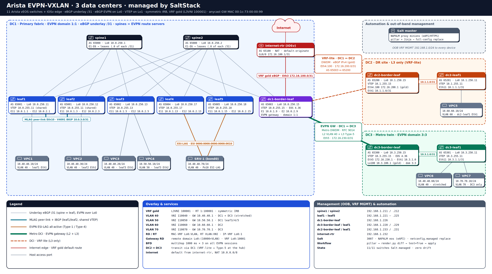
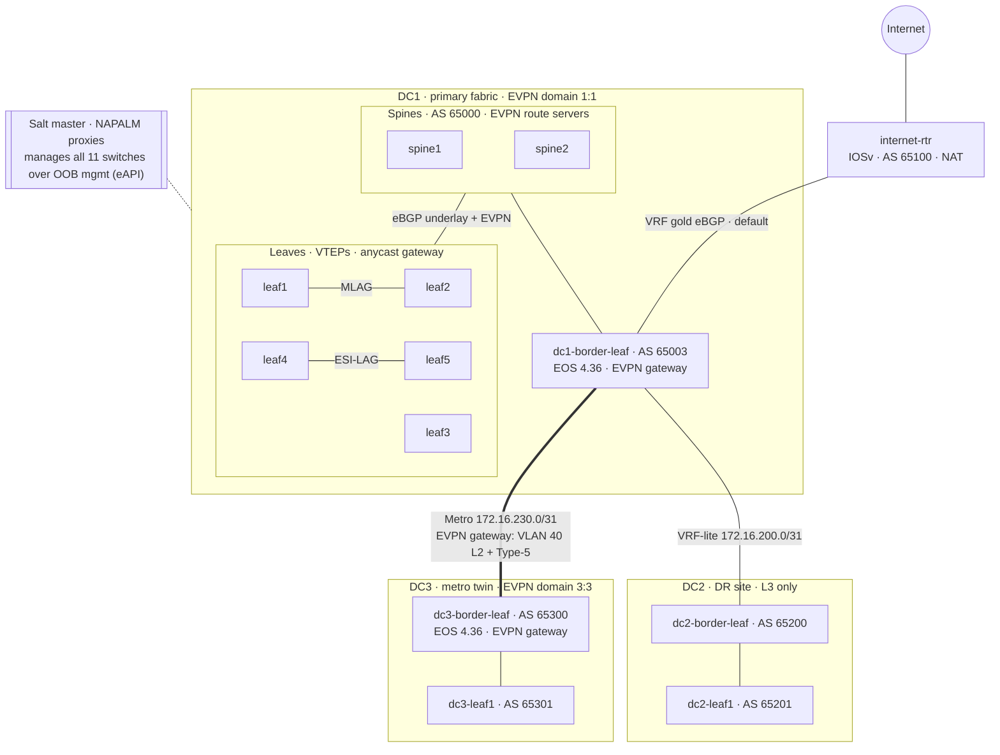
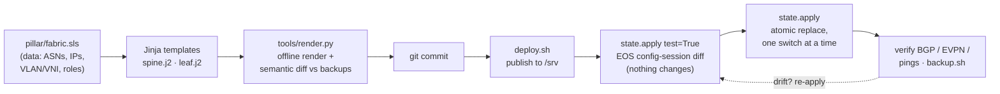

# Arista EVPN-VXLAN Multi-DC Fabric, Automated with SaltStack

A three-data-center Arista EVPN-VXLAN network built in EVE-NG and managed end to end by **SaltStack + NAPALM**.
Every switch configuration is **rendered from a single source of truth** (pillar data + Jinja templates) and pushed
as an **atomic full-config replace**. Drift is detected and reverted; changes are previewed by EOS itself before they land.

| | |
|---|---|
| **Devices** | 11 Arista vEOS switches (3 DCs) + Cisco IOSv internet edge |
| **Overlay** | BGP EVPN, VXLAN, symmetric IRB, anycast gateway, MLAG, EVPN ESI multihoming |
| **DCI** | DC1 ↔ DC3: EVPN multi-domain gateway (RFC 9014), L2 stretch + Type-5 · DC1 ↔ DC2: VRF-lite DR site |
| **Automation** | Salt 3007 · NAPALM proxy minions over eAPI · `netconfig.managed` (replace) · offline render + semantic diff |
| **Result** | All 11 switches Salt-managed, **zero drift**, two hand-built DCs onboarded **without an outage** |

---

## Topology



<sub>Editable source: [docs/diagrams/Topology.drawio](docs/diagrams/Topology.drawio) (open in diagrams.net; File → Export as → VSDX for Visio)</sub>

<details><summary>Simplified view (Mermaid)</summary>



</details>

L1/L2 = MLAG pair (shared VTEP) · L4/L5 = EVPN all-active ESI-LAG (Type-1/Type-4) · details in [docs/ARCHITECTURE.md](docs/ARCHITECTURE.md)

## How the automation works



- **One template, many roles.** A device's behaviour comes from its data, not from a separate template:

| Role | Devices | What gets generated |
|---|---|---|
| `spine` | spine1-2 | Downlinks + underlay/EVPN neighbors generated from every device whose `uplinks` point at it |
| `leaf` | leaf1-5, dc2-leaf1, dc3-leaf1 | VTEP, anycast gateway, MAC-VRFs, IP-VRF; peers = whatever its `uplinks` land on |
| `border` | dc1-border-leaf | Leaf without SVIs + VRF-lite edge (internet, DC2) |
| `border` + hub | dc2/dc3-border-leaf | No spines in that DC: downlinks and BGP to local leaves generated like a spine |
| `border` + `dci_gateway` | dc1/dc3-border-leaf | RFC 9014 gateway: metro underlay + `DCI-UNDERLAY-OUT`, `domain remote` peer, domain IDs, stretched VLANs (remote RD `Lo0:10000+VLAN`), VRF `domain all` RTs |

- **Example: stretch VLAN 50 to DC3** = add `50` to `stretched_vlans` on both gateways and to `vlans:` on dc3-leaf1. Render, preview, apply.
- **Example: add a leaf** = one device entry with its `uplinks:`; both spines get the new downlink, underlay and EVPN neighbor automatically.

## Diagrams and design documents

| | |
|---|---|
|  |  |
| **3-DC design**: metro twin + DR site | **DC1 ↔ DC3 L2 extension** through EVPN gateways |
|  |  |
| **VLAN 40 stretch**: every IP, tunnel and route stamp | **Control plane vs data plane** for the stretch |
|  |  |
| **EVPN route types** per segment | **L2 stretch via gateway**, explained |
|  |  |
| **MLAG** with EVPN (leaf1/leaf2) | **EVPN multihoming**: Type-1 / Type-4 (leaf4/leaf5) |

Design documents (PDF, readable in the browser; Word versions linked):
- [DC1 ↔ DC3 Metro DCI with EVPN Gateways](docs/DC1_DC3_Metro_DCI_EVPN_Gateway.pdf) ([Word](docs/DC1_DC3_Metro_DCI_EVPN_Gateway.docx)): goals, design, configuration walkthrough, route types, test results
- [VLAN 40 Stretch DC1 ↔ DC3](docs/VLAN40_Stretch_DC1_DC3_EVPN.pdf) ([Word](docs/VLAN40_Stretch_DC1_DC3_EVPN.docx)): end-to-end packet and route walk-through

## Repository layout

| Path | What |
|---|---|
| `pillar/fabric.sls` | **Source of truth**: global standards (VLANs, VNIs, VRFs, BFD) + one entry per switch |
| `pillar/users.sls.example` | Template for local-user hashes (real file is git-ignored) |
| `pillar/devices/*.sls` | Per-proxy connection data (NAPALM driver, mgmt IP) |
| `salt/fabric/templates/` | `spine.j2`, `leaf.j2` + shared `_header` / `_mgmt` / `_footer` |
| `salt/fabric/init.sls` | The state: render → `netconfig.managed` with `replace: True` |
| `tools/render.py` | Offline render of all switches + semantic diff against `backups/` (predicts the EOS diff) |
| `tools/backup.sh` | Pull running configs into `backups/` (hashes redacted) |
| `deploy.sh` | Validate templates, publish to `/srv`, refresh pillar |
| `master.d/nodegroups.conf` | Targets: `dc1` `dc2` `dc3` `spines` `leaves` `borders` `gateways` `switches` `routers` `all` |
| `backups/` | Running configs per switch (baseline + current) |
| `docs/` | Architecture, onboarding runbook, drift reports |

## Day-to-day workflow

```bash
vim pillar/fabric.sls                                  # 1. change data, never the switch
/opt/saltstack/salt/bin/python3 tools/render.py        # 2. render all + diff offline
git commit -am "Stretch VLAN 50 to DC3"                # 3. version it
sudo ./deploy.sh                                       # 4. publish to the master
sudo salt -N gateways state.apply fabric test=True     # 5. EOS-computed diff, nothing changes
sudo salt dc1-border-leaf state.apply fabric           # 6. apply one switch, verify, continue
sudo salt -N switches state.apply fabric test=True     # 7. whole-lab drift check
```

## Design decisions

| Decision | Why |
|---|---|
| **Full-config replace**, not merge | The switch ends up exactly as rendered: drift and leftovers are removed, and the commit is atomic (EOS config session) |
| **Offline semantic diff before any push** | Reviewing `render.py` output against backups catches pillar mistakes without touching a device |
| **EVPN multi-domain gateway for DC1↔DC3** instead of one flat EVPN domain | Each DC keeps its own VTEP set and failure domain; only the gateways' VTEPs cross the DCI; BUM traffic crosses once |
| **VRF-lite to DC2** | DR site needs L3 only; simplest, firewall-friendly hand-off |
| **Hub role generated from leaf data** | DCs without spines reuse the spine logic; adding a DC3 leaf configures dc3-border-leaf automatically |
| **`eos_train` per device** | EOS 4.36 shows different default lines than 4.31; one attribute instead of forking the template |
| **Secrets out of git** | eAPI credentials and password hashes live only on the master (`_creds.yaml`, `users.sls`); backups are stored redacted |

## Project phases

- [x] **1–3** Salt master, NAPALM proxy minions, repo with pillar as source of truth
- [x] **4** DC1 (8 switches) templated, drift removed, zero-drift baseline
- [x] **DCI build** DC3 metro twin with EVPN gateways (EOS 4.36), VLAN 40 stretch, Type-5 between DCs, DC2 transit
- [x] **5** DC2 + DC3 onboarded into Salt: hub/gateway roles, 4.36 handling, leaf-first rollout, **11/11 zero drift**
- [ ] Day-2: scheduled backups + drift report
- [ ] internet-rtr (IOSv) via NAPALM `ios`
- [ ] Streaming telemetry: gNMI → gnmic → Prometheus → Grafana, Salt deploys annotated
- [ ] Event-driven: syslog/napalm-logs + Salt reactor (drift auto-revert, BGP-down diagnostics, DCI failover check)
- [ ] GPG-encrypted pillar · CI (render + lint on every pull request)

## Lab environment
Dell R740 · Proxmox · EVE-NG · Arista vEOS-lab 4.31.2F / 4.36.3M · Cisco IOSv 15.9 · Salt 3007 (onedir) · NAPALM.
Management network is a private lab LAN. No credentials are stored in this repository.

## License
MIT
