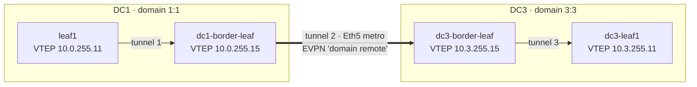
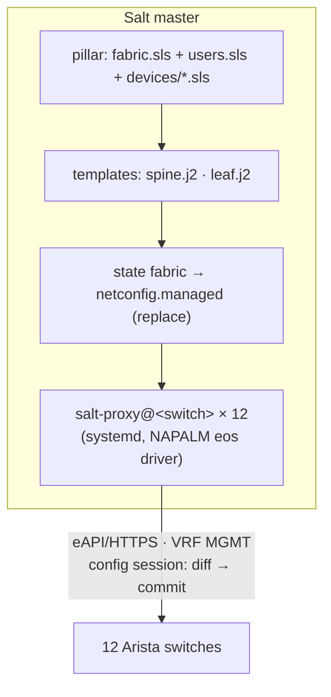

# Architecture

## Devices and addressing

| Device | DC | Role | ASN | Lo0 (EVPN / router-id) | Lo1 (VTEP) | EOS | Mgmt |
|---|---|---|---|---|---|---|---|
| spine1 | DC1 | spine | 65000 | 10.0.250.1 | – | 4.31.2F | .211 |
| spine2 | DC1 | spine | 65000 | 10.0.250.2 | – | 4.31.2F | .212 |
| leaf1 | DC1 | leaf (MLAG) | 65001 | 10.0.250.11 | 10.0.255.11 (shared) | 4.31.2F | .221 |
| leaf2 | DC1 | leaf (MLAG) | 65001 | 10.0.250.12 | 10.0.255.11 (shared) | 4.31.2F | .222 |
| leaf3 | DC1 | leaf | 65002 | 10.0.250.13 | 10.0.255.13 | 4.31.2F | .223 |
| leaf4 | DC1 | leaf (ESI-LAG) | 65004 | 10.0.250.17 | 10.0.255.17 | 4.31.2F | .224 |
| leaf5 | DC1 | leaf (ESI-LAG) | 65005 | 10.0.250.18 | 10.0.255.18 | 4.31.2F | .225 |
| dc1-border-leaf | DC1 | border + EVPN gateway | 65003 | 10.0.250.15 | 10.0.255.15 | 4.36.3M | .226 |
| dc2-border-leaf | DC2 | border (hub) | 65200 | 10.1.250.15 | 10.1.255.15 | 4.31.2F | .233 |
| dc2-leaf1 | DC2 | leaf | 65201 | 10.1.250.11 | 10.1.255.11 | 4.31.2F | .231 |
| dc3-border-leaf | DC3 | border (hub) + EVPN gateway | 65300 | 10.3.250.15 | 10.3.255.15 | 4.36.3M | .228 |
| dc3-leaf1 | DC3 | leaf | 65301 | 10.3.250.11 | 10.3.255.11 | 4.31.2F | .229 |
| internet-rtr | edge | NAT / default route | 65100 | – | – | IOSv 15.9 | .232 |

Underlay: eBGP on /31 point-to-point links (DC1 `10.0.1.x` spine1 / `10.0.2.x` spine2, DC2 `10.1.1.0/31`, DC3 `10.3.1.0/31`).
Overlay: eBGP EVPN between loopbacks (multihop, BFD). Spines are EVPN route servers with `next-hop-unchanged`.
Management: out-of-band, VRF `MGMT`, eAPI over HTTPS.

## Segments

| VLAN | Name | L2 VNI | Gateway (anycast) | Where |
|---|---|---|---|---|
| 40 | APP-40 | 110040 | 10.40.40.1/24 | DC1 leaves + **stretched to DC3** |
| 50 | APP-50 | 110050 | 10.50.50.1/24 | DC1 leaf3/4/5 |
| 60 | APP-60 | 110060 | 10.60.60.1/24 | DC2 |
| 70 | APP-70 | 110070 | 10.70.70.1/24 | DC3 |

VRF `gold`, L3 VNI 100001, RT 1:100001 (symmetric IRB). Anycast gateway MAC `00:1c:73:00:00:99` everywhere, so a VM keeps its gateway after moving between DC1 and DC3.

## DC1 ↔ DC3: EVPN multi-domain gateway (RFC 9014)

- Each gateway **re-originates** EVPN routes into the other domain with its own RD and its own VTEP as next hop,
  so leaves never learn the other DC's VTEPs. A frame from VPC1 to VPC6 crosses three stitched VXLAN tunnels with the inner frame unchanged.
- Route stamps for VPC6 (10.40.40.60): `RD 10.3.250.11:40, NH 10.3.255.11` in DC3 → `RD 10.3.250.15:10040` toward DC1 → `RD 10.0.250.15:40, NH 10.0.255.15` inside DC1.
  Routes received through a gateway carry a **D-PATH** attribute (domain IDs) for loop prevention.
- **Type-3** (flood lists) end at each gateway, so BUM traffic crosses the DCI once.
- **Type-5**: `route-target import/export evpn domain all 1:100001` in VRF gold makes each gateway install the other DC's prefixes and re-advertise them (needs EOS 4.36).
- Metro underlay advertises only Lo0 + Lo1 of each gateway (`DCI-UNDERLAY-OUT`, generated by the template).
- dc3-border-leaf has `Loopback100 10.3.100.1` in VRF gold: a gateway with no SVIs needs an interface in the VRF to keep it active (doubles as a ping target).

| Route type | Crosses the DCI as | Used for |
|---|---|---|
| Type-2 | re-originated | VLAN 40 hosts (MAC/IP) |
| Type-3 | re-originated | VLAN 40 flood list |
| Type-5 | re-originated | DC1 ↔ DC3 subnets, DC2 prefixes in transit |
| Type-1 / Type-4 | stays in DC1 | leaf4/leaf5 ESI-LAG (aliasing, DF election) |

## DC1 ↔ DC2: VRF-lite

dc1-border-leaf `Ethernet4.100` (172.16.200.0/31) ↔ dc2-border-leaf (172.16.200.1/31), eBGP in VRF gold, route-map `DCI-OUT`
(`10.0.0.0/8 le 24` + default from DC1). The hub translates between VRF-lite IPv4 and EVPN Type-5, so DC2 ↔ DC3 traffic transits DC1.

## Internet

internet-rtr originates a default route into VRF gold (eBGP AS 65100 ↔ 65003) and NATs `10.0.0.0/8`. The default reaches every DC
through EVPN Type-5 (DC1, DC3) and VRF-lite (DC2).

## Automation model (Salt)

- Proxy minions run as `salt-proxy@<id>` systemd units with a drop-in that waits for the network and the master and restarts on failure.
- `test=True` opens an EOS configuration session, loads the rendered config, returns EOS's own diff and discards the session.
- Applying commits the session atomically: all lines or none.
- Rollback for any switch: `salt <id> net.load_config filename=$PWD/backups/raw/<id>.cfg replace=True` (the unredacted copy on the master).
